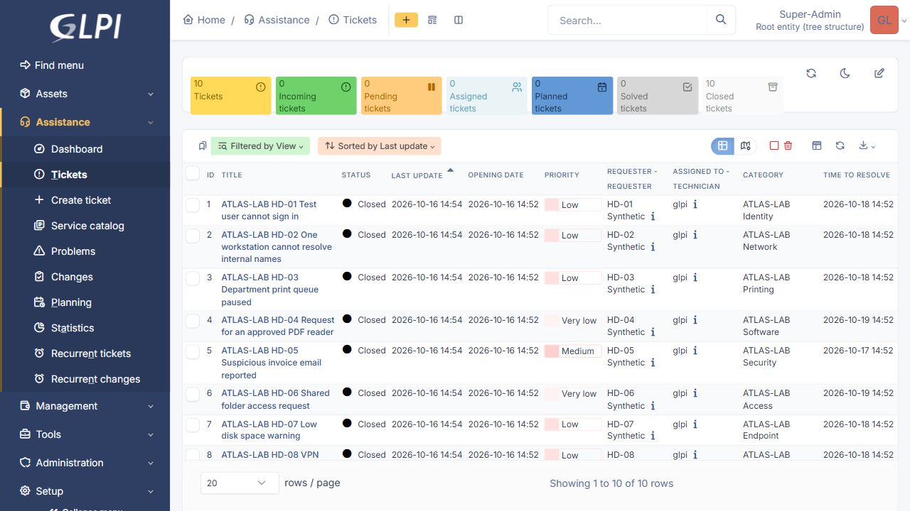
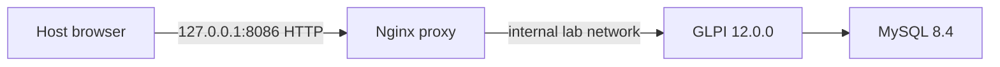

# ATLAS GLPI Helpdesk Lab

Ten synthetic service-desk cases executed in a real local GLPI 12.0.0 installation on 16 October 2026. **Application records and transitions are real; the problems and resolutions are fictional.** No endpoint repair, actual outage or independent requester approval is claimed.

## Verified results

- 10 closed tickets: 8 incidents and 2 requests, with 10 disabled synthetic requesters, 9 categories and one assignment group.
- 10 knowledge articles, one linked to each case. The built-in Home article was preserved.
- 5 priority levels with ownership and resolution targets: 10 actual SLA definitions and calculated due dates for every case.
- HD-08: assigned → pending → assigned → solved → closed.
- HD-09: assigned → solved → reopened → solved → closed; both solutions retained.
- 22 follow-ups and 11 solutions. Final independent verification: **107 passed, 0 failed**.

The ticket table and stored records confirm the total. An initial accessibility snapshot captured zero dashboard counters while they were loading; the saved screenshot shows the settled total of ten closed tickets.

## Execution and correction

An authenticated PHP CLI runner called GLPI domain models inside the dedicated container. This was actual application execution, not a REST API test or ten manually operated browser workflows. Browser sign-in, the ticket list and HD-09 history were inspected afterward.

The initial report contains 99 passing checks, but the first runner failed to retain disabled requesters through automatic requester input. Independent inspection found that gap. A targeted correction added explicit requester relationships without enabling accounts or changing closed status. The final 107-check export verifies those links. The published runner includes the fix, but the revised full runner has **not** been rerun against another fresh database. Check counts overlap; they are not separate successful incidents.

See the [casebook](docs/CASEBOOK.md), [operation guide](docs/OPERATIONS.md), [initial execution](evidence/workflow-results.json), [requester correction](evidence/requester-correction.json), [final verification](evidence/verified-state.json), and [HD-09 audit screenshot](evidence/02-reopen-history.png).

## Architecture

Three official images are pinned by digest. GLPI and MySQL connect only to an internal Docker network. The proxy also connects to a normal bridge and can reach external destinations; this is not an air-gapped system. Only the proxy publishes a port, bound to loopback. Each application/database container is capped at 768 MiB and one CPU; the proxy at 64 MiB and 0.25 CPU. Automatic restarts are disabled. See [observed runtime](evidence/runtime.json).

The local administrator password was randomized. Unused initial post-only, tech and normal accounts were disabled; the system identity was preserved. Database secrets were generated locally. Notifications were disabled; no mail, LDAP, inventory agent, plugin or cloud service was configured. This is a disposable training configuration, not a production hardening claim.

All three own containers were **stopped after verification**, with named data volumes preserved for inspection. See [stop verification](evidence/stopped.json). No Azure resource or paid service was created.

## Limits

- The lab administrator performed triage, assignment, simulated confirmation and closure. No role separation or independent approval was tested.
- SLA targets use a continuous clock. Scheduled escalations, business-hour calendars and actual service performance were not tested. Cron logs included Action aborted; a later status check reported no running, stuck or errored cron tasks. The cause was not established.
- Automated execution took seconds. Timestamps do not represent human response time or work effort. Evidence timestamps use UTC.
- Priority level 5 was configured but not exercised. Due-date calculation is not contractual SLA compliance.
- Required PHP CLI installation checks passed; session-cookie security was skipped by the CLI. Browser access uses local HTTP, not TLS.
- This is an agent-assisted lab, not a claim that a learner independently mastered these skills.

## Official references

- [GLPI 12.0.0 release](https://github.com/glpi-project/glpi/releases/tag/12.0.0)
- [Official container example](https://github.com/glpi-project/docker-images/blob/main/docker-compose.example.yml)
- [Container environment variables](https://github.com/glpi-project/docker-images/blob/main/.env.example)

Configuration intent is kept separate from runtime observations above.

